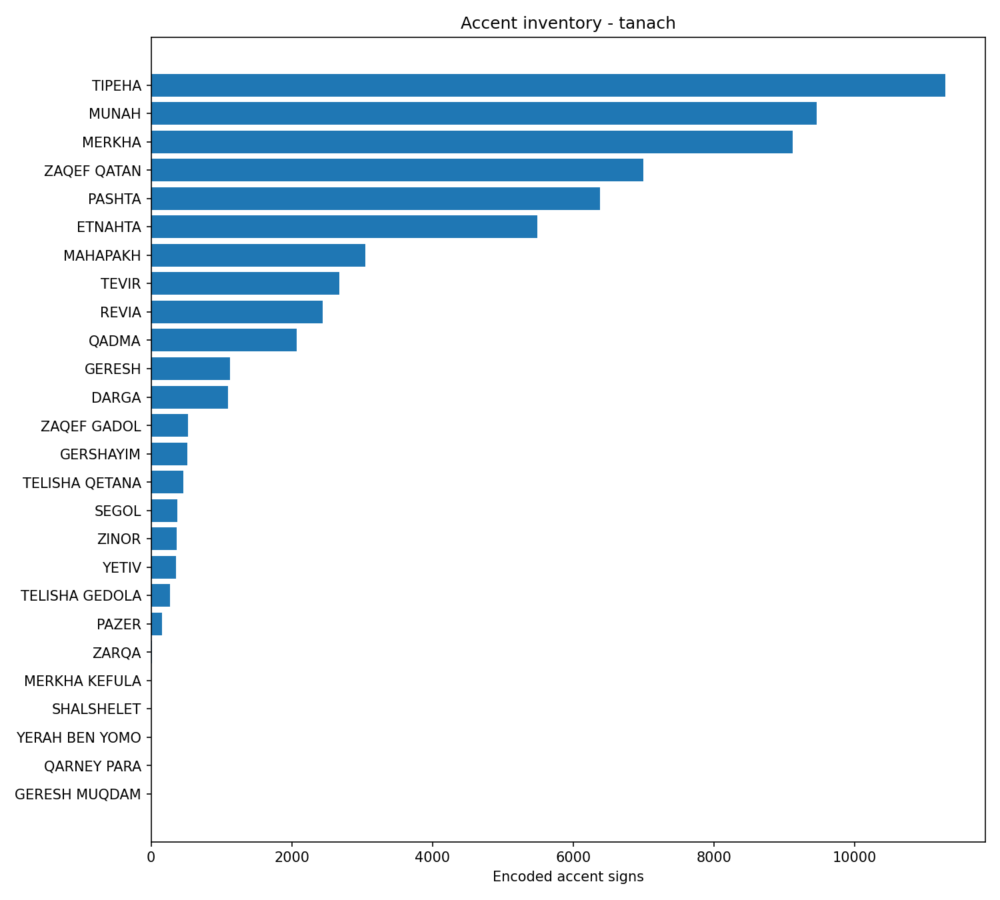

# Torah Cantillation Analysis

[](https://github.com/davidlifschitz/torah-cantillation-analysis/actions/workflows/ci.yml)

**A reproducible, edition-aware study of Torah cantillation: both a statistical atlas and deeper pattern discovery.**

The corpus covers Genesis, Exodus, Leviticus, Numbers and Deuteronomy. Sefaria supplies the source texts; this project preserves edition metadata and raw code points, validates extraction, and generates findings with reusable Python code.

## First completed research run

Snapshot **`primary-20261013`**, edition **Tanach with Ta'amei Hamikra**, completed acquisition, coverage validation, analysis, deterministic offline regeneration, all eleven notebook executions and source archiving. [Research run](https://github.com/davidlifschitz/torah-cantillation-analysis/actions/runs/38435753641) and [CI: 51 tests passed](https://github.com/davidlifschitz/torah-cantillation-analysis/actions/runs/38435753815).

| Computed measure | Result |
| --- | ---: |
| Verses under the source reference scheme | 5,846 |
| Lexical tokens under the current tokenizer | 80,742 |
| Encoded accent signs, U+0591-U+05AE | 64,234 |
| Distinct observed accent code points | 26 |
| Verses eligible for sequence/model analysis | 4,686 |
| Machine-readable analytical report tables | 18 |

These are **digital-encoding counts**, not a claim to have resolved every functional cantillation unit. The literal inventory retains unresolved reading alternatives. Meteg/silluq and other signs are audited separately. Of the 5,846 verses, 1,160 are excluded from sequence/model analysis by explicit ambiguity rules; their raw evidence remains available. [Coverage and provenance](reports/primary-20261013/summary.json), [quality flags](reports/primary-20261013/tables/quality_flags.json), and [methodology](docs/methodology.md) explain the scope.

Read the [computed findings](reports/primary-20261013/findings.md), browse the [executed notebooks](notebooks/), or inspect the [complete report tables](reports/primary-20261013/tables/). Adjacent-mark dependence, clustering and held-out prediction are exploratory analyses, not historical or causal conclusions.



The most frequent encoded signs in this snapshot are TIPEHA (11,290), MUNAH (9,462), MERKHA (9,120), ZAQEF QATAN (6,998) and PASHTA (6,378). Names are Unicode character names; they are not a complete traditional naming taxonomy. Counts come from [inventory.json](reports/primary-20261013/tables/inventory.json).

## Research scope

| Track | Implemented outputs |
| --- | --- |
| Inventory | Encoded accent frequencies, all-sign audit, rare-occurrence references |
| Distribution | Book, chapter and parashah rates per 1,000 lexical tokens, including zeros |
| Sequences | Verse-bounded bigrams/trigrams, conditional probabilities, shuffle-null dependence |
| Structure | Relative token positions, verse lengths and entropy profiles |
| Similarity | Normalized-profile clustering, silhouette diagnostics and seed stability |
| Anomalies | Rare contexts and out-of-book model surprise, with exact references |
| Prediction | Uniform, unigram and bigram baselines evaluated by held-out book |
| Robustness | Literal versus token-distinct representations; optional cross-edition comparison |

The MAM comparison has **not** been run in the published snapshot; its output explicitly says `not_run`. Functional accent hierarchies, resolved qere/ketiv, dual-accented Decalogue passages and a full silluq classifier remain linguistic-review tasks. See [research issues](https://github.com/davidlifschitz/torah-cantillation-analysis/issues) and the [roadmap](docs/roadmap.md).

## Reproduce the published result

Python 3.12+ is required; the first successful CI/research run used Python 3.13.16. Install [uv](https://docs.astral.sh/uv/getting-started/installation/), then:

```bash
git clone https://github.com/davidlifschitz/torah-cantillation-analysis.git
cd torah-cantillation-analysis
uv sync --locked --extra dev
uv run python scripts/snapshot_archive.py restore --snapshot primary-20261013
uv run torah-cantillation reproduce --snapshot primary-20261013
uv run python scripts/check_reproduction.py --snapshot primary-20261013
uv run python scripts/notebooks.py --snapshot primary-20261013 --execute
uv run pytest -q
```

The approved raw response archive is committed at `data/snapshots/primary-20261013.zip`; the extracted raw and rebuilt processed tables are intentionally ignored by Git. Restoration followed by reproduction does **not** contact Sefaria. Installing dependencies still requires network access unless packages are already cached. Save the source commit, snapshot and `uv.lock` when citing results.

The generated reference explorer is `reports/primary-20261013/index.html`; open it locally after cloning. **GitHub Pages has not been deployed.**

### Acquire a new snapshot

```bash
uv run torah-cantillation sources
uv run torah-cantillation fetch --snapshot my-new-snapshot
uv run torah-cantillation build --snapshot my-new-snapshot
uv run torah-cantillation validate --snapshot my-new-snapshot
uv run torah-cantillation analyze --snapshot my-new-snapshot
uv run python scripts/notebooks.py --snapshot my-new-snapshot --execute
```

Fetch is sequential, paced and resumable and does not require a Sefaria API key. `--pilot` fetches chapter 1 in each book and labels reports as a pilot. `--comparison` additionally requests MAM; review [data licensing](DATA_LICENSES.md) before redistribution. Existing snapshots are checksum-verified, never silently refreshed. Use a new snapshot ID when acquiring new source content.

Optional Parquet output: install `uv sync --locked --extra dev --extra parquet`, then add `--parquet` to `build` or `reproduce`. UTF-8 JSONL is the canonical analytical representation.

## Repository map

- `src/torah_cantillation/`: acquisition, evidence tables, validation, analysis and CLI.
- `scripts/`: notebook execution, approved source archiving and deterministic reproduction checks.
- `notebooks/`: eleven executed, explanatory research notebooks.
- `data/snapshots/`, `data/manifests/`: approved raw-source archive and provenance.
- `data/raw/`, `data/processed/`: restored and rebuilt local evidence, ignored by Git.
- `reports/<snapshot>/`: findings, tables, figures, environment records and local verse explorer.
- `docs/`: API sources, counting rules, data dictionary, research log and roadmap.
- `tests/`: offline unit and synthetic end-to-end tests; synthetic fixtures are never findings.

Analytical logic belongs in the tested package, not hidden notebook cells. Every encoded mark preserves its source position; every provisional unit links to its supporting marks. Work-mode continuation instructions are in [docs/execution_prompt.md](docs/execution_prompt.md).

## Interpretation boundary

An encoded sign is not necessarily one functional cantillation unit. The literal layer preserves repetitions. The provisional token-distinct layer collapses identical signs on a token for sensitivity analysis, but does not resolve every linguistic role. U+05BD is audited as meteg-or-silluq; a positional silluq candidate remains a candidate. Unresolved markup and reading alternatives are flagged rather than normalized away.

Counts describe one digital edition, not all manuscripts or melodies. Clusters are not inferred genres; unusual passages are not errors. No historical or causal claim follows merely from an exploratory statistical association. This is a reproducible first research pass, not a final scholarly edition.

## License, citation and contributions

Original software: [MIT](LICENSE). Source text and derived outputs: [DATA_LICENSES.md](DATA_LICENSES.md), not automatically MIT. Upstream attribution remains in the manifest. Cite with [CITATION.cff](CITATION.cff), including the exact source snapshot and code commit.

Read [CONTRIBUTING.md](CONTRIBUTING.md). Research questions, domain review and reproducibility improvements are welcome. Do not commit credentials or manually entered numbers presented as computed findings.
